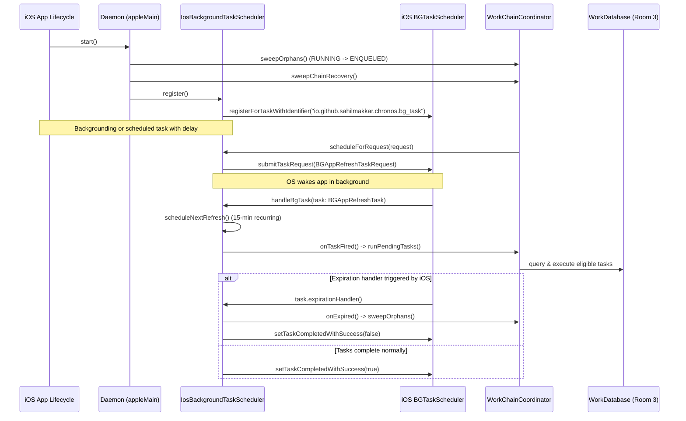

# Chronos — Detailed HLD (Deep Dives)

This document covers the in-depth architecture and design of the four foundational subsystems of Chronos. It bridges the High-Level System Design ([`SYSTEM_DESIGN_HLD_DFD.md`](./SYSTEM_DESIGN_HLD_DFD.md)) and the Low-Level Design ([`LLD.md`](./LLD.md)).

---

## 1. Apple (iOS) Background & Lifecycle Execution Architecture

### The Core Problem
On Apple platforms, background work cannot rely on continuous daemon execution. The operating system strictly limits background execution through battery and resource budgeting. Apple provides `BGTaskScheduler`, which wakes the app opportunistically.
Chronos solves this with a dual-mode execution strategy:
1. **Foreground / Active Execution**: When the app is open or active, tasks execute immediately via coroutines managed by the [`WorkChainCoordinator`](../chronos-core/src/commonMain/kotlin/io/github/sahilmakkar/chronos/roomDb/executor/WorkChainCoordinator.kt).
2. **Background Wakeups via `BGTaskScheduler`**: When tasks have initial delays or the app transitions to the background, [`IosBackgroundTaskScheduler`](../chronos-core/src/appleMain/kotlin/io/github/sahilmakkar/chronos/executor/IosBackgroundTaskScheduler.kt) schedules a `BGAppRefreshTaskRequest` with identifier `io.github.sahilmakkar.chronos.bg_task`.

### Architecture & Component Roles



### Self-Healing & Expiration Protection
- **Expiration Safety**: Apple allocates ~30 seconds for background execution. If tasks run too long, `task.expirationHandler` cancels the running coroutine job and immediately invokes `coordinator.sweepOrphans()`.
- **Orphan Sweeps on Startup**: Any task left in `RUNNING` due to process termination is automatically reset back to `ENQUEUED` on next launch.

---

## 2. WorkChain & DAG Dependency Coordination

### The Core Problem
Chaining tasks (e.g. `A → B → C`) requires strict ordering, data propagation, and failure cascading:
- Task `B` must only execute once Task `A` has reached `SUCCEEDED`.
- If Task `A` fails, downstream dependencies must handle the failure according to the declared [`DependentTaskPolicy`](../chronos-core/src/commonMain/kotlin/io/github/sahilmakkar/chronos/task/policy/DependentTaskPolicy.kt) (`STOP_ON_FAILURE` vs `CONTINUE_ON_FAILURE`).
- Chain state must survive app crashes and process kills without orphaned or permanently stuck child tasks.

### Storage Representation
Dependencies are stored in [`work_dependencies`](../chronos-core/src/commonMain/kotlin/io/github/sahilmakkar/chronos/roomDb/Entities.kt#L83-L108) with cascading foreign keys referencing [`work_requests`](../chronos-core/src/commonMain/kotlin/io/github/sahilmakkar/chronos/roomDb/Entities.kt#L18-L56):

```
work_requests:
┌───────────┬──────────────┬──────────────┬────────────┬───────────┐
│ id        │ workerClass  │ chainId      │ chainOrder │ state     │
├───────────┼──────────────┼──────────────┼────────────┼───────────┤
│ "task-1"  │ FetchWorker  │ "chain-root" │ 0          │ SUCCEEDED │
│ "task-2"  │ ParseWorker  │ "chain-root" │ 1          │ ENQUEUED  │
└───────────┴──────────────┴──────────────┴────────────┴───────────┘

work_dependencies:
┌──────────────┬─────────────┬────────────────────┬─────────────────────────────┐
│ parentWorkId │ childWorkId │ chainFailurePolicy │ parentOutputMergeStrategy   │
├──────────────┼─────────────┼────────────────────┼─────────────────────────────┤
│ "task-1"     │ "task-2"    │ STOP_ON_FAILURE    │ MERGE                       │
└──────────────┴─────────────┴────────────────────┴─────────────────────────────┘
```

### Evaluation Algorithm in `WorkChainCoordinator`

1. **Child Dependency Resolution (`resolveDependencies`)**:
   ```kotlin
   val deps = db.workDao().getDependenciesForChild(entity.id)
   for (dep in deps) {
       val parent = db.workDao().getWorkRequest(dep.parentWorkId)
       if (parent == null || parent.state != TaskState.SUCCEEDED) {
           if (parent?.state == TaskState.FAILED && dep.chainFailurePolicy == DependentTaskPolicy.STOP_ON_FAILURE) {
               db.workDao().updateWorkState(id = entity.id, state = TaskState.FAILED)
           }
           return false
       }
   }
   return true
   ```
2. **Chain Recovery Sweep (`sweepChainRecovery`)**:
   Runs on system initialization and after every task completion. Iterates over all dependencies:
   - If parent is `SUCCEEDED` and child is `ENQUEUED`, schedules child immediately (`scheduledAt = now`).
   - If parent is `FAILED` and child is `ENQUEUED`:
     - If `STOP_ON_FAILURE`: marks child `FAILED`.
     - If `CONTINUE_ON_FAILURE`: schedules child immediately (`scheduledAt = now`).
3. **Retry & Backoff Calculation**:
   ```kotlin
   private fun computeBackoffDelay(entity: WorkRequestEntity, attempt: Int): Long {
       return when (entity.backoffPolicy) {
           BackoffPolicy.LINEAR -> entity.backoffDelayMs * attempt
           BackoffPolicy.EXPONENTIAL -> entity.backoffDelayMs * (1L shl (attempt - 1))
       }
   }
   ```
   If `attempt >= entity.maxRetries`, the task transitions to `TaskState.FAILED`.

---

## 3. KSP Processor Internals (`chronos-processor`)

### The Core Problem
Kotlin/Native on Apple targets does not support JVM reflection (`Class.forName` or reflection-based instantiation). To instantiate workers by string class name dynamically from Room DB entries, Chronos employs a custom compile-time Kotlin Symbol Processing (KSP) plugin.

### Module Architecture

```
chronos-processor/
├── src/main/kotlin/io/github/sahilmakkar/chronos/processor/
│   ├── WorkerProcessorProvider.kt  ← KSP SymbolProcessorProvider entry point
│   └── WorkerProcessor.kt          ← Scans symbols & generates registration code
└── src/main/resources/META-INF/services/
    └── com.google.devtools.ksp.processing.SymbolProcessorProvider
```

### Processing Flow
1. `WorkerProcessor.process()` scans for all classes annotated with `@RegisterWorker`.
2. Inspects constructor parameters and any custom `factory` property on `@RegisterWorker(factory = CustomFactory::class)`.
3. If no custom factory is provided, generates a default factory invocation `register("$qualifiedName") { $qualifiedName(it) }`.
4. Writes the generated Kotlin file `GeneratedWorkers.kt` into package `io.github.sahilmakkar.chronos`.

### Generated Code Sample

```kotlin
package io.github.sahilmakkar.chronos

fun WorkerRegistry.registerGeneratedWorkers() {
    register("com.example.SyncWorker") { SyncWorker(it) }
    // Custom factory classes are skipped for manual registration
}
```

---

## 4. Constraint Verification Architecture

### The Core Problem
Tasks declare execution prerequisites ([`EnvironmentConstraints`](../chronos-core/src/commonMain/kotlin/io/github/sahilmakkar/chronos/task/constraints/EnvironmentConstraints.kt)). The execution coordinator must verify these constraints before launching a task.

### The Unified Verifier
Defined as an `expect` class in `commonMain` and implemented across platform source sets:

```kotlin
// commonMain
expect class WorkConstraintVerifier {
    fun isSatisfied(entity: WorkRequestEntity): Boolean
}
```

### Platform Implementations

#### 1. Apple (`appleMain`)
Evaluates:
- **Network**: Uses [`IosNetworkChecker`](../chronos-core/src/appleMain/kotlin/io/github/sahilmakkar/chronos/IosNetworkChecker.kt) via `NWPathMonitor`. Validates `isConnected()` and unmetered connection (`!path.isExpensive`).
- **Battery & Charging**: Uses `UIDevice.currentDevice` (`isBatteryMonitoringEnabled = true`).
  - Charging: `batteryState == UIDeviceBatteryStateCharging || UIDeviceBatteryStateFull`.
  - Battery Not Low: `batteryLevel >= 0.20f`.
- **Storage**: Uses `NSFileManager.defaultManager.attributesOfFileSystemForPath` to ensure free disk space > 100 MB.
- **Time Window**: Evaluates local hour against [`TimeWindow`](../chronos-core/src/commonMain/kotlin/io/github/sahilmakkar/chronos/task/constraints/TimeWindow.kt) using `kotlinx-datetime`.

#### 2. JVM Desktop (`jvmMain`)
Evaluates:
- **Network**: Uses [`JvmNetworkChecker`](../chronos-core/src/jvmMain/kotlin/io/github/sahilmakkar/chronos/JvmNetworkChecker.kt) via Java `NetworkInterface.getNetworkInterfaces()`.
- **Storage**: Checks `File(System.getProperty("user.home")).usableSpace > 100_000_000L`.
- **Time Window**: Evaluates `allowedTimeWindow` using `kotlinx-datetime`.

#### 3. Android (`androidMain`)
On Android, hardware constraints (network, charging, battery, storage, idle) are mapped directly to WorkManager constraints via [`WorkConstraintsMapper`](../chronos-core/src/androidMain/kotlin/io/github/sahilmakkar/chronos/mapper/WorkConstraintsMapper.kt):
```kotlin
fun WorkRequestEntity.toWorkManagerConstraints(): Constraints =
    Constraints.Builder()
        .setRequiredNetworkType(networkType.toWorkManagerNetworkType())
        .setRequiresCharging(requiresCharging)
        .setRequiresBatteryNotLow(requiresBatteryNotLow)
        .setRequiresStorageNotLow(requiresStorageNotLow)
        .setRequiresDeviceIdle(requiresDeviceIdle)
        .build()
```
WorkManager natively suspends and schedules task execution based on OS constraint broadcasts.
