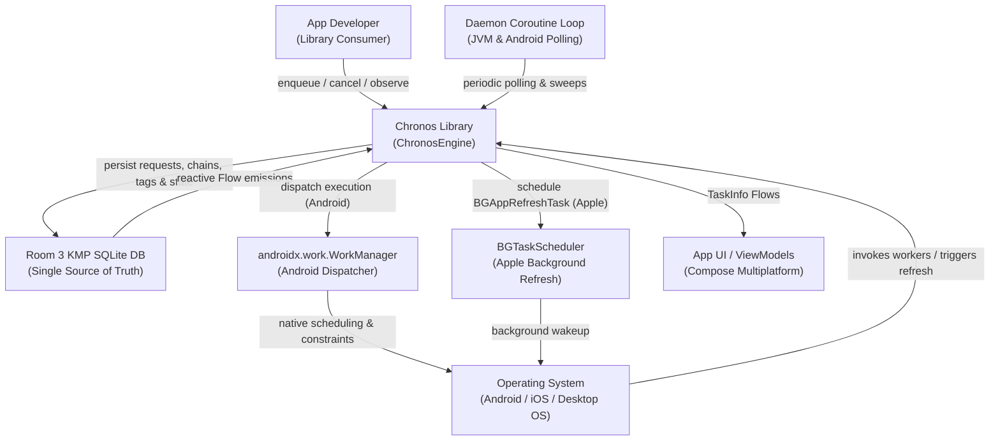
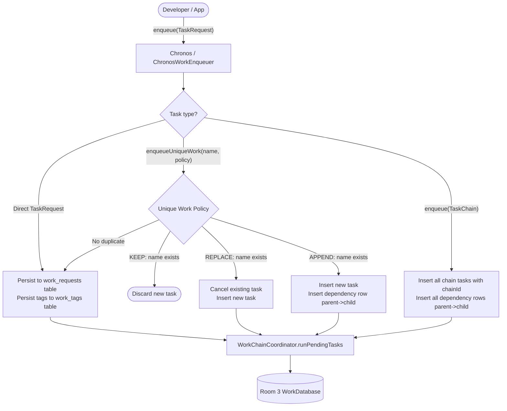
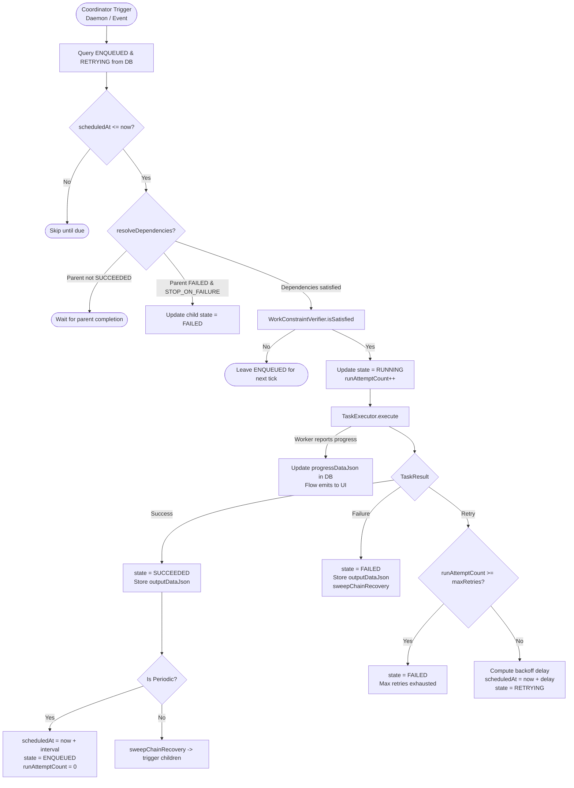
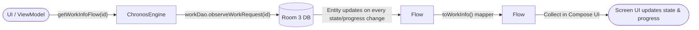
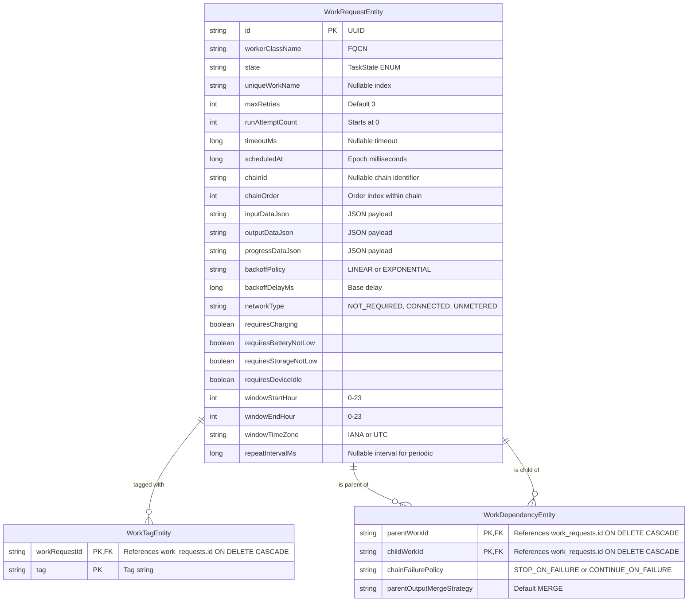
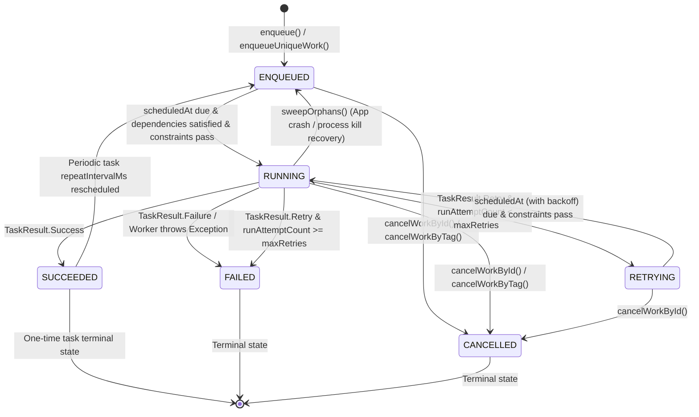

# Chronos — System Design, HLD & DFD

This document consolidates the complete System Design, High-Level Design (HLD), and Data Flow Diagrams (DFD) for Chronos, reflecting the current Kotlin Multiplatform (KMP) architecture and codebase reality. For detailed class-level signatures, schemas, and execution algorithms, see [`LLD.md`](./LLD.md). For deep dives into specific subsystems, see [`HLD_DEEP_DIVES.md`](./HLD_DEEP_DIVES.md).

---

## 1. System Context (Level 0 DFD)

The highest-level system context diagram shows the interactions between the app developer, the unified Chronos library, platform schedulers, persistence, and the UI layer.



---

## 2. System Architecture Overview

### 2.1 Module Boundaries

Chronos is organized into four clean modules:

```
┌────────────────────────────────────────────────────────────────────────┐
│                           Chronos Ecosystem                            │
│                                                                        │
│  ┌───────────────────────────────────────────────────────────────┐    │
│  │                 chronos-core  (KMP Library)                   │    │
│  │                                                               │    │
│  │  commonMain          androidMain      appleMain      jvmMain  │    │
│  │  ──────────          ───────────      ─────────      ───────  │    │
│  │  • Chronos API       • WorkManager    • BGTask-      • Timer  │    │
│  │  • ChronosEngine       Delegate         Scheduler      Daemon │    │
│  │  • WorkChainCoord.   • AndroidTask-   • WorkTask-    • Jvm-   │    │
│  │  • Room 3 WorkDB       Executor         Executor       Network│    │
│  │  • Worker & TaskData • Android-       • IosNetwork-  • Work-  │    │
│  │  • TaskRequest         Delegating-      Checker        Task-  │    │
│  │  • Constraints         Worker         • Apple-         Exec.  │    │
│  │  • WorkerRegistry    • Daemon Loop      Daemon                │    │
│  └───────────────────────────────────────────────────────────────┘    │
│                                                                        │
│  ┌──────────────────────┐     ┌──────────────────────────────────┐    │
│  │  chronos-processor   │     │         chronos-testing          │    │
│  │  (JVM-only KSP)      │     │         (KMP Library)            │    │
│  │                      │     │                                  │    │
│  │  • WorkerProcessor   │     │  • TestChronos                   │    │
│  │  • Provider & Codegen│     │  • FakeClock                     │    │
│  │  • @RegisterWorker   │     │  • Task assertions & stubs       │    │
│  └──────────────────────┘     └──────────────────────────────────┘    │
│                                                                        │
│  ┌─────────────────────────────────────────────────────────────────┐  │
│  │                       sample/  (CMP App)                        │  │
│  │    Android Target      iOS / Apple Target     Desktop JVM       │  │
│  │    Interactive UI for queueing, chaining, and live observing    │  │
│  └─────────────────────────────────────────────────────────────────┘  │
└────────────────────────────────────────────────────────────────────────┘
```

### 2.2 Layer Architecture

Chronos follows a 4-layer design ensuring clean abstraction and decoupling:

```
┌────────────────────────────────────────────────────────┐
│                  LAYER 1: PUBLIC API                   │  ← Developer-facing
│     Chronos, TaskRequest, TaskChain, TaskData, Worker  │    Pure Kotlin Multiplatform
└───────────────────────────┬────────────────────────────┘
                            │
┌───────────────────────────▼────────────────────────────┐
│              LAYER 2: PERSISTENCE (ROOM 3)             │  ← Single source of truth
│   WorkDatabase, WorkDao, WorkRequestEntity,            │    Across ALL platforms
│   WorkTagEntity, WorkDependencyEntity                  │    (Android, Apple, JVM)
└───────────────────────────┬────────────────────────────┘
                            │
┌───────────────────────────▼────────────────────────────┐
│         LAYER 3: ORCHESTRATION & COORDINATION          │  ← Central brain
│   WorkChainCoordinator, Daemon, ChronosWorkEnqueuer,   │    Orphan recovery, retry,
│   ChronosWorkCanceller, WorkConstraintVerifier         │    backoff, DAG dependency
└───────────────────────────┬────────────────────────────┘
                            │
┌───────────────────────────▼────────────────────────────┐
│            LAYER 4: PLATFORM EXECUTION ENGINES         │  ← Platform-specific
│   Android: AndroidTaskExecutor + WorkManager           │    dispatchers & hooks
│   Apple:   WorkTaskExecutor + IosBackgroundTaskSched.  │
│   JVM:     WorkTaskExecutor + Coroutine Polling Daemon │
└────────────────────────────────────────────────────────┘
```

---

## 3. High-Level Component Diagram

```mermaid
graph TD
    subgraph commonMain["chronos-core: commonMain"]
        API["Chronos (interface)"]
        ENG["ChronosEngine"]
        COORD["WorkChainCoordinator"]
        WDAO["WorkDao"]
        WDB["WorkDatabase (Room 3)"]
        REG["WorkerRegistry"]
        WORKER["Worker (abstract)"]
        REQ["TaskRequest (OneTime / Periodic)"]
        CHAIN["TaskChain"]
        DATA["TaskData / workDataOf"]
        CONST["EnvironmentConstraints & TimeWindow"]
        NC["NetworkChecker (interface)"]
        WCV["WorkConstraintVerifier (expect)"]
    end

    subgraph processor["chronos-processor (JVM KSP)"]
        ANN["@RegisterWorker annotation"]
        WP["WorkerProcessor"]
        GEN["GeneratedWorkers.kt"]
    end

    subgraph androidMain["chronos-core: androidMain"]
        ATE["AndroidTaskExecutor"]
        ADW["AndroidDelegatingWorker"]
        ANC["AndroidNetworkChecker"]
        ADMN["Daemon (Android 1s poll)"]
    end

    subgraph appleMain["chronos-core: appleMain"]
        WTE_AP["WorkTaskExecutor"]
        IBTS["IosBackgroundTaskScheduler"]
        INC["IosNetworkChecker"]
        IDMN["Daemon (Apple BGTask + sweeps)"]
    end

    subgraph jvmMain["chronos-core: jvmMain"]
        WTE_JVM["WorkTaskExecutor"]
        JNC["JvmNetworkChecker"]
        JDMN["Daemon (JVM 1s poll)"]
    end

    subgraph testing["chronos-testing (KMP)"]
        TCH["TestChronos"]
        FC["FakeClock"]
    end

    API --> ENG
    ENG --> COORD
    ENG --> WDB
    WDB --> WDAO
    COORD --> WDAO
    COORD --> WCV
    WCV --> NC

    ANN --> WP --> GEN --> REG
    REG --> WORKER

    COORD --> ATE
    ATE --> ADW
    ANC --> NC

    COORD --> WTE_AP
    IDMN --> IBTS
    INC --> NC

    COORD --> WTE_JVM
    JNC --> NC

    API -.->|test double| TCH
```



---

## 4. Platform Execution Architecture

### 4.1 Android Execution Flow
On Android, `WorkDatabase` remains the authoritative state store. When a task is ready, `WorkChainCoordinator` dispatches it to `AndroidTaskExecutor`, which wraps it in a WorkManager request. WorkManager handles native system execution conditions, invoking `AndroidDelegatingWorker`, while retry and backoff logic remain strictly governed by `WorkChainCoordinator`.

```
Developer calls Chronos.enqueue()
        │
        ▼
ChronosWorkEnqueuer inserts WorkRequestEntity & WorkTagEntity into WorkDatabase (Room 3)
        │
        ▼
Daemon (1s poll) or immediate trigger calls WorkChainCoordinator.runPendingTasks()
        │
        ├── Checks scheduledAt <= now
        ├── Resolves DAG dependencies from work_dependencies
        └── Calls AndroidTaskExecutor.execute(entity, inputData)
                │
                ▼
        Builds androidx.work.OneTimeWorkRequest<AndroidDelegatingWorker>
        (Passes workerClassName and inputDataJson in WorkManager Data)
        (Sets WorkManager Constraints from EnvironmentConstraints)
                │
                ▼
        WorkManager.enqueue(request)
                │
                ▼
        OS schedules and triggers AndroidDelegatingWorker.doWork()
                │
                ├── WorkerRegistry.createWorker(workerClassName, inputData)
                ├── Sets progress listener bridging to WorkManager setProgress()
                └── Invokes Worker.doWork() -> TaskResult
                │
                ▼
        AndroidTaskExecutor observes WorkManager Flow and maps result back to TaskResult
                │
                ▼
        WorkChainCoordinator handles TaskResult:
        • Success  -> SUCCEEDED, saves outputDataJson, triggers child chain tasks
        • Failure  -> FAILED, cascades STOP_ON_FAILURE if configured
        • Retry    -> Evaluates maxRetries; calculates backoff delay; sets RETRYING
```

### 4.2 Apple / iOS Execution Flow
On iOS, execution happens either in the foreground via coroutines or when awakened by iOS `BGTaskScheduler` (`BGAppRefreshTask` with ID `io.github.sahilmakkar.chronos.bg_task`).

```
                    ┌──────────────────────────────────────────┐
                    │            APP IS FOREGROUND             │
                    │                                          │
                    │  Daemon starts CoroutineScope            │
                    │  1. Runs sweepOrphans() (RUNNING -> ENQ) │
                    │  2. Runs sweepChainRecovery()            │
                    │  3. Registers BGAppRefreshTask           │
                    │  4. Runs runPendingTasks()               │
                    └──────────────────────────────────────────┘
                                      │
                         App moves to background / scheduled delay
                                      ▼
                    ┌──────────────────────────────────────────┐
                    │         BGTaskScheduler SCHEDULED        │
                    │                                          │
                    │  IosBackgroundTaskScheduler submits      │
                    │  BGAppRefreshTaskRequest with            │
                    │  earliestBeginDate = delay / 15 mins     │
                    └──────────────────────────────────────────┘
                                      │
                         iOS wakes app in background
                                      ▼
                    ┌──────────────────────────────────────────┐
                    │            OS WAKES APP (BGTask)         │
                    │                                          │
                    │  1. Schedules next BGAppRefreshTask      │
                    │  2. Launches onTaskFired()               │
                    │  3. WorkChainCoordinator.runPending()    │
                    │  4. WorkTaskExecutor executes workers    │
                    │  5. Expiration handler cancels coroutine │
                    │     and sweeps orphans                   │
                    │  6. setTaskCompletedWithSuccess(true)    │
                    └──────────────────────────────────────────┘
```

### 4.3 JVM Desktop Execution Flow
On JVM Desktop, Chronos uses a background coroutine daemon running on `Dispatchers.Default`:

```
App launches -> Chronos.initialize(PlatformSupport, registry)
    │
    ▼
ChronosEngine initializes
    ├── sweepOrphans() (recovers any uncompleted RUNNING tasks from prior crashes)
    ├── sweepChainRecovery() (promotes children of SUCCEEDED parents)
    └── Daemon starts coroutine polling loop (POLL_INTERVAL_MS = 1000ms)
           │
           │  while (coroutineScope.isActive) {
           │      WorkChainCoordinator.runPendingTasks()
           │          • Queries ENQUEUED / RETRYING tasks from Room DB
           │          • Verifies scheduledAt <= now
           │          • Verifies parent dependencies in work_dependencies
           │          • Verifies constraints via WorkConstraintVerifier
           │          • Dispatches to WorkTaskExecutor
           │              - Creates worker from WorkerRegistry
           │              - Executes with optional withTimeout(timeoutMs)
           │              - Updates progress in Room DB
           │          • Applies backoff delay & reschedules if TaskResult.Retry
           │      delay(1000ms)
           │  }
```

---

## 5. Data Flow Diagrams (DFD)

### 5.1 Level 1 DFD — Task Scheduling & Enqueuing



### 5.2 Level 1 DFD — Task Execution & Self-Healing



### 5.3 Level 1 DFD — State Observability



---

## 6. Data Model (Entity Relationship Diagram)



---

## 7. Task State Machine



---

## 8. Platform Capability & Constraint Matrix

| Capability / Constraint | Android | Apple (iOS) | JVM Desktop | Implementation Details |
|---|---|---|---|---|
| **Storage Engine** | Room 3 KMP | Room 3 KMP | Room 3 KMP | Authoritative SQLite database across all platforms |
| **Worker Execution** | [`AndroidTaskExecutor`](../chronos-core/src/androidMain/kotlin/io/github/sahilmakkar/chronos/executor/AndroidTaskExecutor.kt) | [`WorkTaskExecutor`](../chronos-core/src/appleMain/kotlin/io/github/sahilmakkar/chronos/executor/TaskExecutor.apple.kt) | [`WorkTaskExecutor`](../chronos-core/src/commonMain/kotlin/io/github/sahilmakkar/chronos/roomDb/executor/WorkTaskExecutor.kt) | Coroutine-driven workers with optional timeout |
| **Trigger Mechanism** | 1s Daemon loop + WorkManager | `BGTaskScheduler` (`BGAppRefreshTask`) + sweeps | 1s Daemon coroutine loop | Self-healing orphan sweeps on initialization |
| **`NetworkType.CONNECTED`** |  Native `ConnectivityManager` |  `NWPathMonitor` |  `NetworkInterface.isUp` | Checked via [`NetworkChecker`](../chronos-core/src/commonMain/kotlin/io/github/sahilmakkar/chronos/network/NetworkChecker.kt) |
| **`NetworkType.UNMETERED`** |  Native capabilities |  `!path.isExpensive` | ⚠️ Best-effort | Fallback to connected check |
| **`requiresCharging`** |  Native `WorkManager` |  `UIDeviceBatteryStateCharging` / `Full` | ⚠️ No-op | Handled natively or verified before run |
| **`requiresBatteryNotLow`** |  Native `WorkManager` |  `batteryLevel >= 0.20` | ⚠️ No-op | 20% battery threshold |
| **`requiresStorageNotLow`** |  Native `WorkManager` |  `NSFileSystemFreeSize > 100MB` |  `usableSpace > 100MB` | 100MB free threshold |
| **`requiresDeviceIdle`** |  Native Doze Mode | ⚠️ No-op (`@BestEffortOnIOS`) | ⚠️ No-op (`@BestEffortOnJVM`) | Documented compile-time annotations |
| **`allowedTimeWindow`** |  `kotlinx-datetime` |  `kotlinx-datetime` |  `kotlinx-datetime` | Supports local timezone & overnight intervals |
| **Task Chaining (DAG)** |  `WorkChainCoordinator` |  `WorkChainCoordinator` |  `WorkChainCoordinator` | Uniform Room-backed DAG evaluation |
| **Unique Work Policies** |  `KEEP`, `REPLACE`, `APPEND` |  `KEEP`, `REPLACE`, `APPEND` |  `KEEP`, `REPLACE`, `APPEND` | Managed uniformly by `ChronosWorkEnqueuer` |
