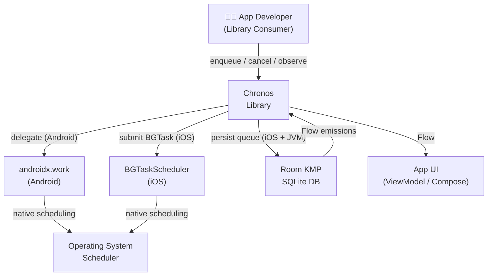
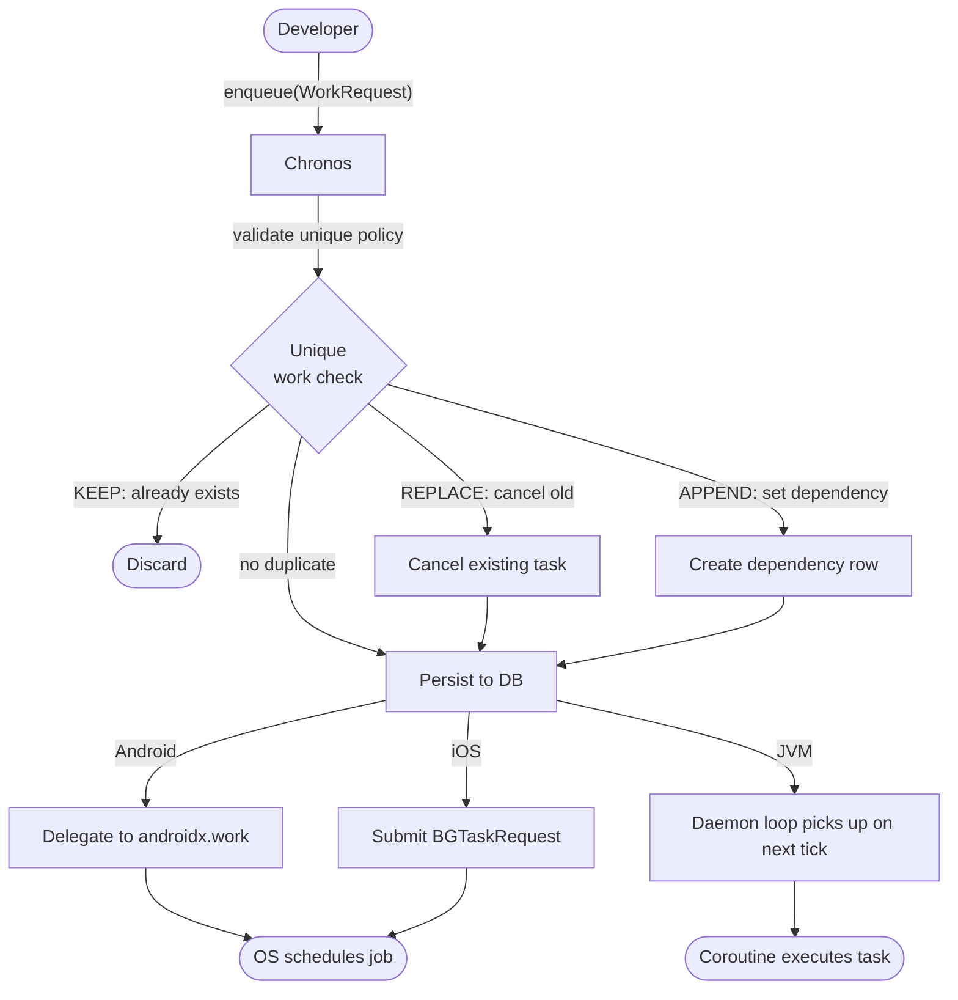
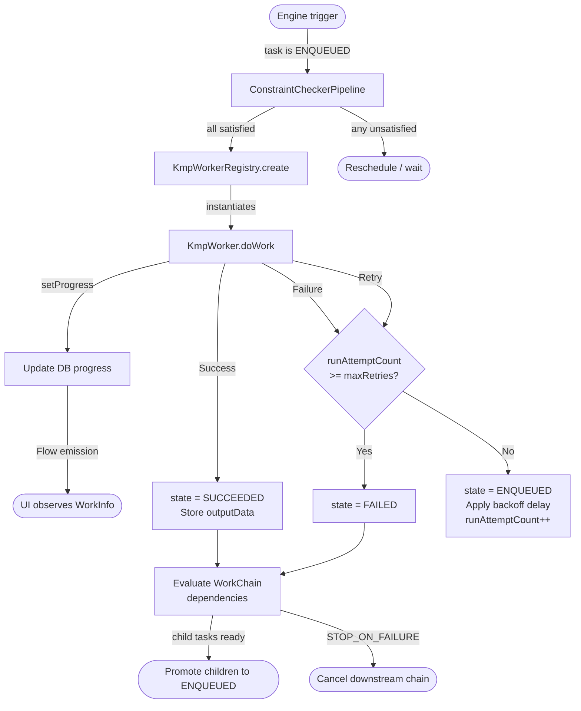
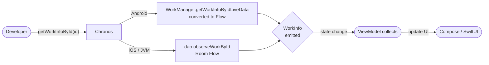
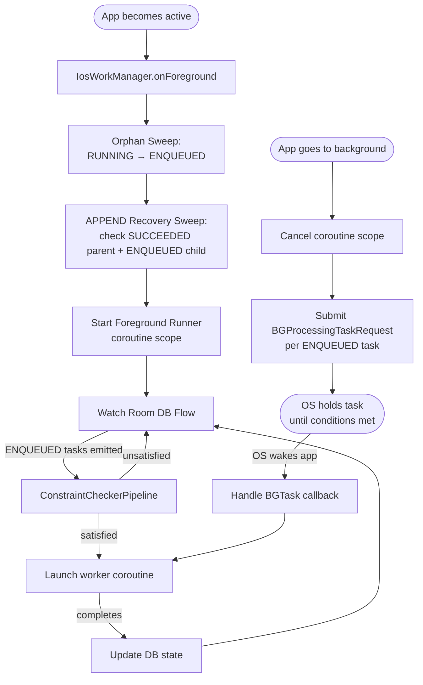
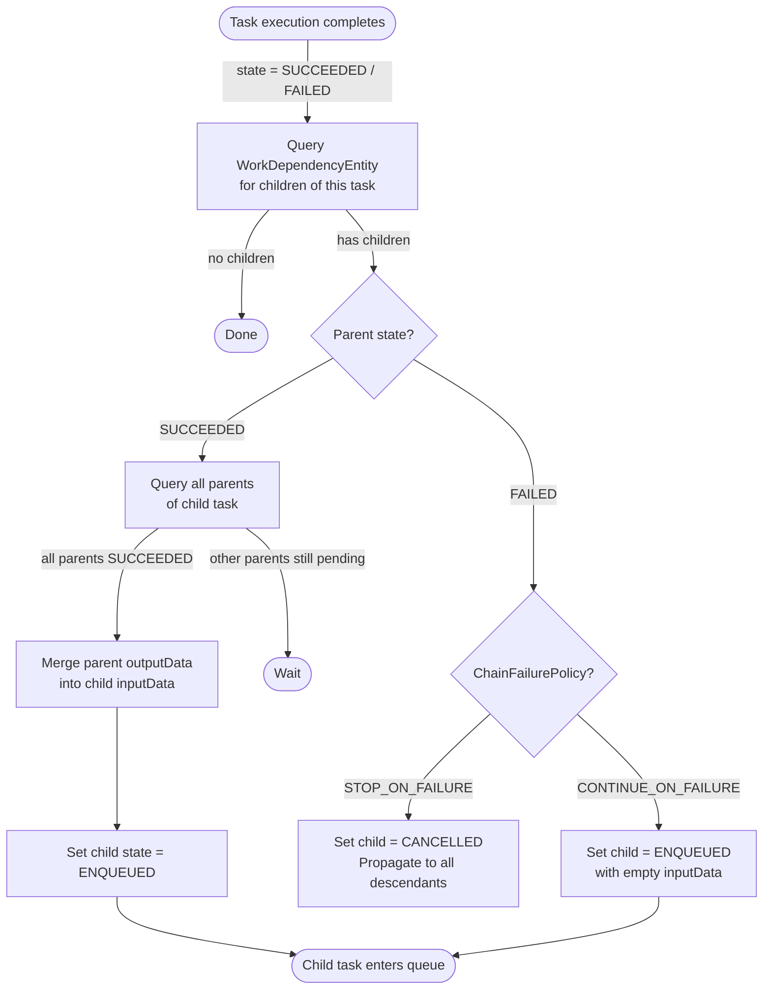
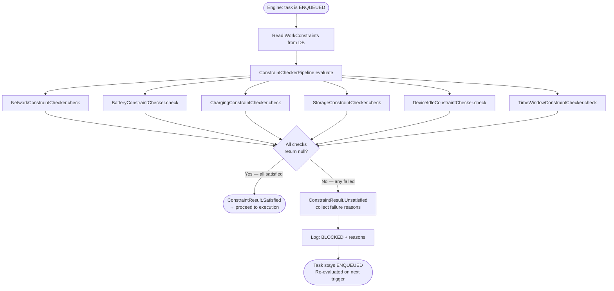
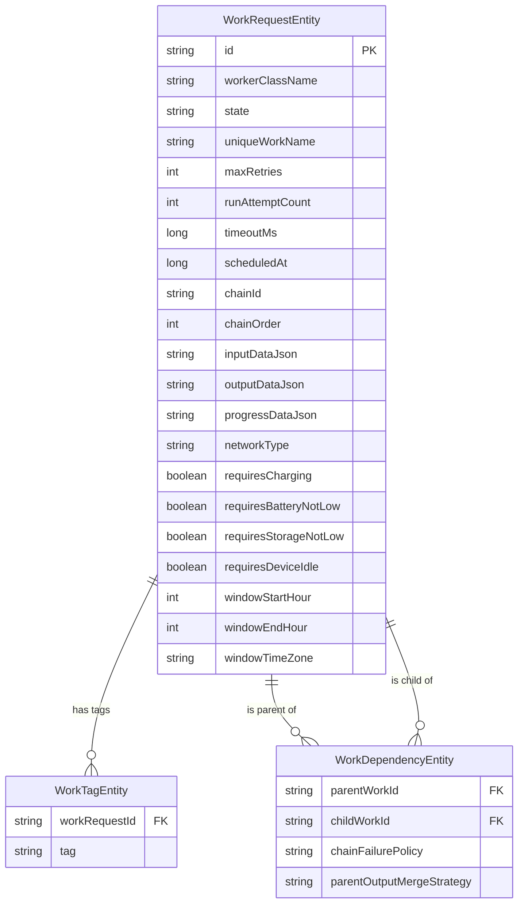
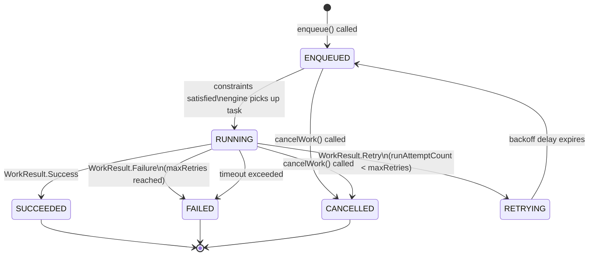

# Chronos — System Design, HLD & DFD

This document consolidates the complete System Design, High-Level Design (HLD), and Data Flow Diagrams (DFD) for Chronos. LLD (Low Level Design) is a separate document.

---

## 1. System Context (Level 0 DFD)

The highest-level view. What is the system, who uses it, and what does it talk to?



---

## 2. System Architecture Overview

### 2.1 Module Boundaries

```
┌──────────────────────────────────────────────────────────────────────┐
│                           Chronos Ecosystem                          │
│                                                                      │
│  ┌─────────────────────────────────────────────────────────────┐    │
│  │                  chronos-core  (KMP Library)                │    │
│  │                                                             │    │
│  │  commonMain       androidMain      iosMain      jvmMain     │    │
│  │  ──────────       ───────────      ───────      ───────     │    │
│  │  Public API       androidx.work    BGTask +     Coroutine   │    │
│  │  Interfaces       delegate         Room KMP     Loop +      │    │
│  │  WorkData                          Engine       Room KMP    │    │
│  │  WorkChain                                      Engine      │    │
│  │  Constraints                                               │    │
│  │  KmpClock                                                  │    │
│  │  NetworkChecker                                            │    │
│  └─────────────────────────────────────────────────────────────┘    │
│                                                                      │
│  ┌──────────────────────┐   ┌──────────────────────────────────┐    │
│  │  chronos-processor   │   │     chronos-testing              │    │
│  │  (JVM-only KSP)      │   │     (KMP)                        │    │
│  │                      │   │                                  │    │
│  │  @RegisterWorker     │   │  TestChronos                     │    │
│  │  SymbolProcessor     │   │  FakeClock                       │    │
│  │  CodeGenerator       │   │  simulateSuccess/Failure         │    │
│  └──────────────────────┘   └──────────────────────────────────┘    │
│                                                                      │
│  ┌───────────────────────────────────────────────────────────────┐  │
│  │                     sample/  (CMP App)                        │  │
│  │    Android Target    iOS Target    Desktop Target             │  │
│  │    Debug Inspector Screen + Live WorkInfo observation         │  │
│  └───────────────────────────────────────────────────────────────┘  │
└──────────────────────────────────────────────────────────────────────┘
```

### 2.2 Layer Architecture

```
┌───────────────────────────────────────────┐
│           LAYER 1: PUBLIC API             │  ← Developer-facing
│     Chronos interface (commonMain)        │    No platform details leak here
└─────────────────┬─────────────────────────┘
                  │
┌─────────────────▼─────────────────────────┐
│       LAYER 2: COMPILE-TIME CODEGEN       │  ← KSP processor runs here
│   chronos-processor generates             │    Eliminates manual registry
│   registerGeneratedWorkers()              │    Solves iOS no-reflection
└─────────────────┬─────────────────────────┘
                  │
┌─────────────────▼─────────────────────────┐
│     LAYER 3: PLATFORM SCHEDULING ENGINES  │  ← expect / actual per platform
│   Android: androidx.work delegate         │
│   iOS:     BGTaskScheduler + Foreground   │
│   JVM:     Coroutine daemon loop          │
└─────────────────┬─────────────────────────┘
                  │
┌─────────────────▼─────────────────────────┐
│        LAYER 4: PERSISTENCE               │  ← iOS + JVM only
│   Room KMP (WorkRequestEntity,            │    Android uses WorkManager's
│   WorkTagEntity, WorkDependencyEntity)    │    internal SQLite
└───────────────────────────────────────────┘
```

---

## 3. Component Diagram (HLD)

```mermaid
graph TD
    subgraph commonMain["commonMain — Shared API"]
        API["Chronos (interface)"]
        WR["WorkRequest / WorkChain"]
        WD["WorkData + workDataOf"]
        WC["WorkConstraints"]
        WORKER["KmpWorker (abstract)"]
        REGISTRY["KmpWorkerRegistry"]
        CLOCK["KmpClock / SystemClock"]
        NC["NetworkChecker (interface)"]
        CCP["ConstraintCheckerPipeline"]
        PC["PlatformCapabilities"]
    end

    subgraph processor["chronos-processor (JVM KSP)"]
        ANN["@RegisterWorker annotation"]
        SP["RegisterWorkerProcessor"]
        CG["CodeGenerator → registerGeneratedWorkers()"]
    end

    subgraph androidMain["androidMain"]
        AWM["AndroidWorkManager"]
        ADW["AndroidDelegatingWorker (CoroutineWorker)"]
        ANC["AndroidNetworkChecker"]
    end

    subgraph iosMain["iosMain"]
        IWM["IosWorkManager"]
        IFR["IosForegroundRunner"]
        IBG["IosBGTaskScheduler"]
        INC["IosNetworkChecker"]
        ICK["IosConstraintCheckers"]
    end

    subgraph jvmMain["jvmMain"]
        JWM["JvmWorkManager"]
        JQL["JvmQueueExecutor (daemon loop)"]
        JNC["JvmNetworkChecker"]
        JCK["JvmConstraintCheckers"]
    end

    subgraph roomdb["Room KMP DB (iOS + JVM)"]
        WRE["WorkRequestEntity"]
        WTE["WorkTagEntity"]
        WDE["WorkDependencyEntity"]
        DAO["WorkRequestDao"]
    end

    subgraph testing["chronos-testing"]
        TWM["TestChronos"]
        FC["FakeClock"]
    end

    API --> AWM
    API --> IWM
    API --> JWM
    ANN --> SP --> CG --> REGISTRY
    AWM --> ADW
    IWM --> IFR
    IWM --> IBG
    IFR --> CCP
    JQL --> CCP
    CCP --> NC
    INC --> NC
    JNC --> NC
    ANC --> NC
    IFR --> DAO
    JQL --> DAO
    DAO --> WRE
    DAO --> WTE
    DAO --> WDE
    API -.->|test double| TWM
    CLOCK -.->|test double| FC
```



---

## 4. Platform Execution Architecture

### 4.1 Android Execution Flow

```
Developer calls enqueue()
        │
        ▼
AndroidWorkManager
        │
        │  Maps WorkRequest → OneTimeWorkRequest / PeriodicWorkRequest
        │  Maps WorkConstraints → Constraints.Builder()
        │  Maps UniqueWorkPolicy → ExistingWorkPolicy
        │
        ▼
androidx.work.WorkManager.enqueue()
        │
        ▼
WorkManager's internal Room DB (sqlite)
        │
        ▼
OS schedules via JobScheduler (API 23+)
        │
        ▼
OS triggers AndroidDelegatingWorker (CoroutineWorker)
        │
        ▼
AndroidDelegatingWorker.doWork()
        │
        │  registry.create(workerClassName, inputData)
        │
        ▼
Developer's KmpWorker.doWork() executes
        │
        ▼
WorkResult → mapped back to ListenableWorker.Result
```

### 4.2 iOS Execution Architecture

```
                    ┌──────────────────────────────────────┐
                    │         APP IS FOREGROUND             │
                    │                                      │
                    │   IosForegroundRunner                │
                    │   (Coroutine Scope, active)          │
                    │                                      │
                    │   Watches Room DB Flow ──────────────┤
                    │   for ENQUEUED tasks                 │
                    │   Runs them immediately              │
                    └──────────────────────────────────────┘
                                    ▲  │
                              open  │  │ background
                                    │  ▼
                    ┌──────────────────────────────────────┐
                    │      APP GOES TO BACKGROUND           │
                    │                                      │
                    │  1. Cancel coroutine scope           │
                    │  2. Submit BGProcessingTaskRequest   │
                    │     for each ENQUEUED task           │
                    │     (with earliestBeginDate)         │
                    └──────────────────────────────────────┘
                                    │
                           OS decides when to run
                                    │
                                    ▼
                    ┌──────────────────────────────────────┐
                    │      OS WAKES APP (BGTask)            │
                    │                                      │
                    │  BGTaskScheduler callback fires      │
                    │  IosWorkManager.handleBGTask()       │
                    │  Run pending tasks via engine        │
                    │  Call task.setTaskCompleted()        │
                    └──────────────────────────────────────┘
                                    │
                           app foregrounded or
                           next BGTask trigger
                                    │
                                    ▼
                    ┌──────────────────────────────────────┐
                    │       APP LAUNCH / FOREGROUND         │
                    │                                      │
                    │  1. Orphan Sweep                     │
                    │     RUNNING → ENQUEUED               │
                    │  2. APPEND Chain Recovery Sweep      │
                    │  3. runPendingTasksNow()             │
                    │  4. Foreground runner resumes        │
                    └──────────────────────────────────────┘
```

### 4.3 JVM Desktop Execution Architecture

```
App starts
    │
    ▼
JvmWorkManager.initialize()
    │
    ├── Orphan Sweep (RUNNING → ENQUEUED)
    ├── APPEND Chain Recovery Sweep
    └── Start daemon coroutine loop
           │
           │  while (isActive) {
           │      val dueTasks = dao.getTasksDueNow(clock.now())
           │      dueTasks.forEach { task ->
           │          if (constraintPipeline.evaluate(task.constraints)
           │                 is Satisfied) {
           │              launchWorker(task)
           │          }
           │      }
           │      delay(POLL_INTERVAL) // e.g. 15 seconds
           │  }
           │
    ┌──────┴─────────────────────────────┐
    │  Worker coroutines (one per task)  │
    │  withTimeout(task.timeoutMs) {     │
    │      worker.doWork()               │
    │  }                                 │
    └────────────────────────────────────┘
```

---

## 5. Data Flow Diagrams (DFD)

### 5.1 Level 1 DFD — Task Scheduling



### 5.2 Level 1 DFD — Task Execution



### 5.3 Level 1 DFD — State Observability



### 5.4 Level 1 DFD — iOS App Lifecycle & Persistence



### 5.5 Level 2 DFD — WorkChain Evaluation



### 5.6 Level 2 DFD — KSP Code Generation

```mermaid
flowchart TD
    A([Developer writes:\n@RegisterWorker\nclass SyncWorker]) --> B[Kotlin Compiler\ninvokes KSP]
    B --> C[RegisterWorkerProvider.create]
    C --> D[RegisterWorkerProcessor.process]
    D --> E[resolver.getSymbolsWithAnnotation\n@RegisterWorker]
    E --> F{Valid class?}
    F -->|"not KmpWorker subclass"| G([KSP error: compile fails])
    F -->|"valid"| H[Build WorkerDescriptor\nqualifiedName, factory?]
    H --> I{Has factory\nparam?}
    I -->|"No"| J["generate:\nregister(name) { SyncWorker(it) }"]
    I -->|"Yes"| K["generate:\nregister(name, SyncWorkerFactory())"]
    J --> L[Write GeneratedWorkerRegistry.kt]
    K --> L
    L --> M([Kotlin compiler includes\ngenerated file in build])
    M --> N([Developer calls:\nregistry.registerGeneratedWorkers()])
```

### 5.7 Level 2 DFD — Constraint Checker Pipeline



---

## 6. Data Model (Entity Relationship Diagram)



---

## 7. WorkState Machine



---

## 8. Platform Capability & Constraint Matrix

| Constraint | Android | iOS | JVM Desktop |
|---|---|---|---|
| `NetworkType.CONNECTED` | ✅ Native `ConnectivityManager` | ✅ `NWPathMonitor` | ✅ `NetworkInterface` poll |
| `NetworkType.UNMETERED` | ✅ Native | ⚠️ `NWPath.isExpensive` | ❌ No-op (documented) |
| `requiresCharging` | ✅ Native `BatteryManager` | ✅ `UIDevice.batteryState` | ⚠️ Best-effort `SystemInfo` |
| `requiresBatteryNotLow` | ✅ Native | ✅ `UIDevice.batteryLevel > 0.20` | ✅ True if AC detected |
| `requiresStorageNotLow` | ✅ Native | ✅ `volumeAvailableCapacity` | ✅ `File.usableSpace` |
| `requiresDeviceIdle` | ✅ Native Doze | ❌ No-op (documented) | ❌ No-op (documented) |
| `allowedTimeWindow` | ✅ `kotlinx-datetime` | ✅ `kotlinx-datetime` | ✅ `kotlinx-datetime` |
| `initialDelay` | ✅ Native | ⚠️ `earliestBeginDate` (best-effort) | ✅ `kotlinx-datetime` delay |
| `timeout` | ✅ Native | ✅ `withTimeout` coroutine | ✅ `withTimeout` coroutine |
| Periodic tasks | ✅ Guaranteed | ⚠️ OS-deferred (best-effort) | ✅ Guaranteed (app open) |
| Background execution | ✅ Reliable | ⚠️ OS-controlled budget | ✅ App-lifetime only |
| Task chaining | ✅ `WorkContinuation` | ✅ Custom Room engine | ✅ Custom Room engine |
| Unique work policy | ✅ `enqueueUniqueWork` | ✅ Custom Room engine | ✅ Custom Room engine |
| Progress reporting | ✅ `setProgressAsync` | ✅ Room DB update + Flow | ✅ Room DB update + Flow |

---

## 9. Distribution Artifact Map

```
Maven Central:
│
├── io.github.sahilmakkar:chronos-core:1.0.0
│    └── Targets: android, iosArm64, iosSimulatorArm64, jvm
│
├── io.github.sahilmakkar:chronos-processor:1.0.0
│    └── KSP annotation processor (JVM only)
│
└── io.github.sahilmakkar:chronos-testing:1.0.0
     └── TestChronos + FakeClock (KMP)
```

---

## 10. What This Document Covers vs What Comes Next

| Document | Covers |
|---|---|
| `VISION_AND_EXECUTION.md` | Why we build, principles, learning steps, decisions locked |
| `project_plan.md` | Phases, schema, API surface, test checklist |
| `SYSTEM_DESIGN_HLD_DFD.md` (this file) | Architecture, components, data flows, state machines |
| `LLD.md` *(next)* | Class-level design, function signatures, error handling, edge cases per module |
