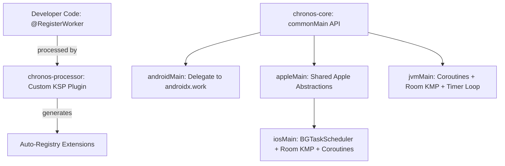

# Chronos — Technical Project Plan (v5.0)

This document is the **technical blueprint** for building Chronos. It covers architecture, API design, database schema, implementation phases, and the platform constraint matrix. For the vision, strategy, and execution philosophy, see `VISION_AND_EXECUTION.md`.

---

## 1. Architecture Overview



### Module Structure
```
Chronos/
├── chronos-core/          # Main KMP library
│   ├── commonMain/
│   ├── androidMain/
│   ├── appleMain/             # Shared Apple abstractions
│   ├── iosMain/
│   └── jvmMain/
├── chronos-processor/     # Custom KSP annotation processor
├── chronos-testing/       # TestChronos + FakeClock
└── sample/                    # Compose Multiplatform sample app
```

---

## 2. Core API Design

### A. Worker Definition & KSP Registry

```kotlin
// Default constructor — KSP auto-generates factory
@RegisterWorker
class SyncWorker(data: WorkData) : KmpWorker(data) {
    override suspend fun doWork(): WorkResult { ... }
}

// DI constructor — developer provides custom factory
@RegisterWorker(factory = UploadWorkerFactory::class)
class UploadWorker(data: WorkData, val api: ApiClient) : KmpWorker(data)
```

**KSP generates:**
```kotlin
// AUTO-GENERATED BY chronos-processor
fun KmpWorkerRegistry.registerGeneratedWorkers() {
    register("com.example.SyncWorker") { SyncWorker(it) }
    // UploadWorker deferred to UploadWorkerFactory
}
```

### B. WorkResult States
```kotlin
sealed class WorkResult {
    data class Success(val outputData: WorkData = workDataOf()) : WorkResult()
    data class Failure(val outputData: WorkData = workDataOf()) : WorkResult()
    object Retry : WorkResult()
}
```

### C. WorkData & DSL Helper
```kotlin
// Type-safe key-value container for String, Int, Boolean, Double, Long
val data = workDataOf(
    "userId"    to "abc-123",
    "forceSync" to true,
    "retryCount" to 3,
    "threshold" to 0.85,
    "timestamp" to System.currentTimeMillis() // Long survives round-trips
)
```

### D. Constraints
```kotlin
data class WorkConstraints(
    val requiredNetworkType: NetworkType = NetworkType.NOT_REQUIRED,
    val requiresCharging: Boolean = false,
    val requiresBatteryNotLow: Boolean = false,
    val requiresStorageNotLow: Boolean = false,  // NEW
    val requiresDeviceIdle: Boolean = false,      // NEW (no-op on iOS/JVM)
    val allowedTimeWindow: TimeWindow? = null     // NEW
)

data class TimeWindow(
    val startHour: Int,   // 0-23
    val endHour: Int,     // 0-23
    val timeZone: TimeZone = TimeZone.UTC
)

enum class NetworkType { NOT_REQUIRED, CONNECTED, UNMETERED }
```

### E. WorkRequest Builders (Full DSL Example)
```kotlin
val syncRequest = OneTimeWorkRequest.Builder(SyncWorker::class)
    .setInputData(workDataOf("userId" to "42"))
    .setConstraints(
        WorkConstraints.Builder()
            .setRequiredNetworkType(NetworkType.CONNECTED)
            .setRequiresBatteryNotLow(true)
            .setRequiresStorageNotLow(true)
            .setAllowedTimeWindow(TimeWindow(startHour = 2, endHour = 5))
            .build()
    )
    .setInitialDelay(10.minutes)
    .setTimeout(15.minutes)
    .setBackoffCriteria(BackoffPolicy.EXPONENTIAL, initialDelay = 5.minutes, maxRetries = 3)
    .addTag("user-sync")
    .build()
```

### F. WorkChain & ChainFailurePolicy
```kotlin
Chronos.instance
    .beginWith(fetchRequest)
    .then(processRequest, onFailure = ChainFailurePolicy.STOP_ON_FAILURE)
    .then(uploadRequest)
    .enqueue()

enum class ChainFailurePolicy { STOP_ON_FAILURE, CONTINUE_ON_FAILURE }
```

**APPEND chain crash recovery (startup sweep):**
On app startup, before `runPendingTasksNow()` is called, the iOS/JVM scheduler must sweep `WorkDependencyEntity` for rows where:
- `parentWorkId` state = `SUCCEEDED`
- `childWorkId` state = `ENQUEUED`

And immediately promote those children to ready-to-run. This ensures chains survive process kills between task transitions.

### G. Platform Capabilities API
```kotlin
// Runtime inspection of what is natively enforced vs best-effort on the current platform
data class PlatformCapabilities(
    val periodicTasksGuaranteed: Boolean,
    val initialDelayPrecise: Boolean,
    val backgroundExecutionReliable: Boolean,
    val networkConstraintNative: Boolean,
    val deviceIdleSupported: Boolean
)

Chronos.instance.platformCapabilities() // Returns platform-specific instance
```

For compile-time documentation, use `@BestEffortOnIOS` KDoc annotation on any API that has degraded iOS behavior.

---

## 3. Room DB Schema

### WorkRequestEntity
| Column | Type | Purpose |
|--------|------|---------|
| `id` | `String` (PK) | Unique task ID |
| `workerClassName` | `String` | Maps to factory in registry |
| `state` | `String` | Current `WorkState` |
| `uniqueWorkName` | `String?` | Enforce unique work policies |
| `maxRetries` | `Int` | Cap retry attempts |
| `runAttemptCount` | `Int` | Track current attempt |
| `timeoutMs` | `Long?` | Execution timeout |
| `scheduledAt` | `Long` | Epoch ms for delay calculation |
| `chainId` | `String?` | Groups chained tasks |
| `chainOrder` | `Int` | Execution order within chain |
| `inputDataJson` | `String` | Serialized WorkData |
| `outputDataJson` | `String` | Serialized output |
| `progressDataJson` | `String` | Serialized progress |
| `networkType` | `String` | `NetworkType` enum value |
| `requiresCharging` | `Boolean` | Charging constraint |
| `requiresBatteryNotLow` | `Boolean` | Battery constraint |
| `requiresStorageNotLow` | `Boolean` | Storage constraint |
| `requiresDeviceIdle` | `Boolean` | Idle constraint (no-op iOS/JVM) |
| `windowStartHour` | `Int?` | Time window start (0-23) |
| `windowEndHour` | `Int?` | Time window end (0-23) |
| `windowTimeZone` | `String?` | Time zone ID for window |

### WorkTagEntity
| Column | Type | Purpose |
|--------|------|---------|
| `workRequestId` | `String` (FK) | References WorkRequestEntity |
| `tag` | `String` | Tag value |

### WorkDependencyEntity
| Column | Type | Purpose |
|--------|------|---------|
| `parentWorkId` | `String` (FK) | Parent task ID |
| `childWorkId` | `String` (FK) | Child task ID |
| `chainFailurePolicy` | `String` | `STOP_ON_FAILURE` / `CONTINUE_ON_FAILURE` |
| `parentOutputMergeStrategy` | `String` | How to merge multiple parent outputs |

### Migration Strategy
```kotlin
@Database(
    entities = [WorkRequestEntity::class, WorkTagEntity::class, WorkDependencyEntity::class],
    version = 1,
    exportSchema = true // Commit schema JSON to version control
)
abstract class WorkDatabase : RoomDatabase()
```
- Export schema JSON on every version bump.
- Write explicit migrations per version.
- `fallbackToDestructiveMigration()` as debug-only opt-in.

---

## 4. NetworkChecker Interface (commonMain)

Decided before Phase 4 schema design — `NetworkChecker` lives in `commonMain` with platform `actual` implementations, making it swappable and testable.

```kotlin
// commonMain
interface NetworkChecker {
    fun isConnected(): Boolean
    fun isUnmetered(): Boolean
}

// androidMain — uses ConnectivityManager (native)
// iosMain    — uses NWPathMonitor (native)
// jvmMain    — uses NetworkInterface.getNetworkInterfaces() poll
//              UNMETERED is a documented no-op on JVM Desktop
```

---

## 5. Clock Interface (commonMain)

Kotlin officially supports time via `kotlinx-datetime`. We use `Clock` and `Instant` directly — no need for a custom `Long`-based abstraction.

```kotlin
import kotlinx.datetime.Clock
import kotlinx.datetime.Instant
import kotlin.time.Duration

interface KmpClock {
    fun now(): Instant
}

object SystemClock : KmpClock {
    override fun now(): Instant = Clock.System.now()
}

// Test double (Phase 3b)
class FakeClock(var currentTime: Instant = Instant.fromEpochMilliseconds(0)) : KmpClock {
    fun advanceBy(duration: Duration) { currentTime += duration }
    override fun now(): Instant = currentTime
}
```

---

## 6. Implementation Phases

| Phase | Module | Description |
|-------|--------|-------------|
| **1** | Setup | Gradle, version catalog, KMP targets (Android, iOS, JVM). macOS commented out for v1.0. |
| **2** | `chronos-processor` | KSP processor, `@RegisterWorker` with optional `factory` param, code generation |
| **2b** | Spike | BGTaskScheduler POC + **Room KMP iOS stress test on real device** before API finalization |
| **3** | `chronos-core` commonMain | WorkData, WorkResult, WorkState, KmpWorker, KmpClock, NetworkChecker, builders, WorkChain, ChainFailurePolicy, PlatformCapabilities |
| **3b** | `chronos-testing` skeleton | FakeClock, TestChronos stub — created here, not Phase 8 |
| **4** | Room DB | Entities (all columns from section 3), DAOs, schema export, migration config |
| **5** | androidMain | Delegate to androidx.work, AndroidDelegatingWorker |
| **6** | appleMain / iosMain | AppleWorkManager, BGTaskScheduler, orphan sweep, APPEND chain recovery sweep, foreground runner |
| **7** | jvmMain | JvmWorkManager, daemon coroutine loop, NetworkInterface checker |
| **8** | `chronos-testing` full | Full test suite — unique policies, chain sequencing, retry caps, timeout cancellation, APPEND crash recovery |
| **9** | Sample App + Publishing | CMP sample app, debug inspector, Maven Central config, README |

---

## 7. Platform Constraint Support Matrix

| Constraint | Android | iOS | JVM Desktop |
|---|---|---|---|
| `NetworkType.CONNECTED` | ✅ Native | ✅ NWPathMonitor | ✅ NetworkInterface poll |
| `NetworkType.UNMETERED` | ✅ Native | ⚠️ Best-effort | ❌ No-op (documented) |
| `requiresCharging` | ✅ Native | ✅ UIDevice | ⚠️ Best-effort via SystemInfo |
| `requiresBatteryNotLow` | ✅ Native | ✅ Calculated >20% | ✅ True if plugged in |
| `requiresStorageNotLow` | ✅ Native | ✅ volumeAvailableCapacity | ✅ File.usableSpace |
| `requiresDeviceIdle` | ✅ Native Doze | ❌ No-op | ❌ No-op |
| `allowedTimeWindow` | ✅ Custom | ✅ Custom | ✅ Custom |
| `initialDelay` | ✅ Native | ⚠️ Best-effort | ✅ Coroutine delay |
| `timeout` | ✅ Native | ✅ withTimeout | ✅ withTimeout |
| Periodic tasks | ✅ Guaranteed | ⚠️ OS-deferred | ✅ Guaranteed (app open) |
| Background execution | ✅ Reliable | ⚠️ OS-controlled | ✅ App-lifetime only |

---

## 8. Minimum OS Targets

| Platform | Minimum | Reason |
|---|---|---|
| Android | API 23 | `androidx.work` minimum |
| iOS | iOS 13.0 | `BGTaskScheduler` requirement |
| JVM Desktop | JDK 11 | Coroutines + Room KMP |
| macOS | *Backlog* | Post-launch via `appleMain` |
| Web/WASM | *Never* | No persistent background execution in browsers |

---

## 9. Test Coverage Checklist (Phase 8)

- [ ] `WorkData` `Long` survives serialization round-trips on all platforms
- [ ] Unique work: `KEEP` ignores duplicate, `REPLACE` cancels old, `APPEND` sequences correctly
- [ ] Chain `STOP_ON_FAILURE` halts downstream tasks
- [ ] Chain `CONTINUE_ON_FAILURE` runs downstream with empty input
- [ ] APPEND chain startup sweep recovers `SUCCEEDED parent → ENQUEUED child`
- [ ] Orphaned task sweep resets `RUNNING → ENQUEUED` on crash recovery
- [ ] Retry count increments correctly and stops at `maxRetries`
- [ ] Timeout cancels task and marks `FAILED`
- [ ] Tag-based cancellation cancels all matching tasks
- [ ] `allowedTimeWindow` blocks execution outside specified hours
- [ ] `requiresStorageNotLow` blocks execution when storage is critical
- [ ] `FakeClock.advanceBy()` correctly triggers overdue periodic tasks

---

## 10. Future Backlog (Post-Launch)

1. **macOS native target** — `NSBackgroundActivityScheduler` + `appleMain` shared code
2. **Background Downloader** — `URLSession` background downloads (iOS), `DownloadManager` (Android)
3. **Exact Alarm Triggers** — Android `AlarmManager` wrapper
4. **Visual Dependency Graph** — Compose debug inspector rendering `A → B → C`
5. **Cellular data constraints** — Low-data / data saver mode awareness
6. **Koin integration sample** — Official guide showing `KoinWorkerFactory` pattern

---

## 11. Room KMP iOS Validation (Phase 2b Checklist)

> ⚠️ Must be done on a **real iOS device**, not just a simulator.

- [ ] WAL mode stability under `BGTaskScheduler` background process lifecycle
- [ ] Thread safety under concurrent reads/writes during app suspension/resume
- [ ] Data integrity after force-quit mid-write
- [ ] Flow emissions update correctly after app resume from background

**Exit criteria for fallback to SQLDelight:**
If WAL mode causes data loss or write failures on 2+ real device models during the above tests, switch to SQLDelight before Phase 4 begins.
